# RL2 Snake Robot

## 仓库地图

该组织仓库包含**14自由度自研蛇形机器人**的模型文件、model-based算法、深度强化学习算法以及真机部署代码的全链路实现。

### 基本步态

#### [snake-basic-gait](https://github.com/RL2-snake-robot/snake-basic-gait)

基于 **MuJoCo** 的基础步态仿真：用开环正弦关节轨迹实现 4 种经典步态（Serpentine / Creeping / Rolling / Sidewinding），另补 U 型翻滚（U-Rolling）与横向行波（Lateral-Wave），并提供基于 Matsuoka 振荡器的 **CPG 闭环控制器**（在两种步态模式间切换、转弯、分阶段停机），另有步态参数扫描与多机型（自由度族 × 轮型）对比。

下列 GIF 由 `make_previews.py` 在 MuJoCo 场景内录制，为 **2.5 倍速**：

| Serpentine（蜿蜒） | Creeping（蠕动） | Rolling（翻滚） | U-Rolling（U 型翻滚） |
| :---: | :---: | :---: | :---: |
| 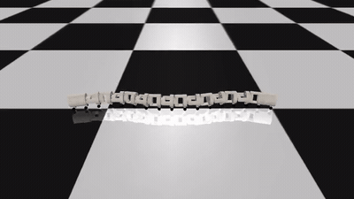 | 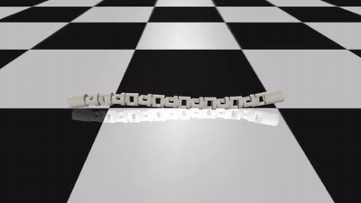 | 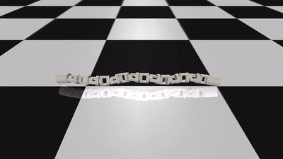 | 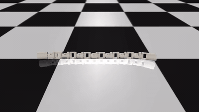 |

| Lateral-Wave（横向行波） | Sidewinding（侧移） | CPG-Serpentine | CPG-Creeping |
| :---: | :---: | :---: | :---: |
| 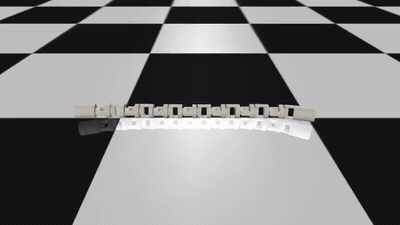 | 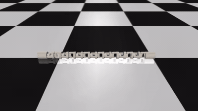 |  | 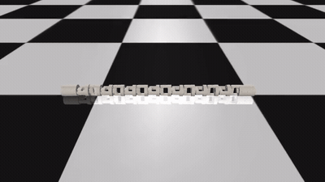 |

### 深度强化学习

#### [snake-gym-velocity-tracking](https://github.com/RL2-snake-robot/snake-gym-velocity-tracking)

由 [legged_gym](https://github.com/leggedrobotics/legged_gym) 改造而来的 Isaac Gym 速度跟踪环境，新增两个蛇形机器人环境包，仅用本体感知观测跟踪给定的线速度 / 偏航角速度指令（上游四足 / 双足环境 `anymal_b`、`anymal_c_flat`、`anymal_c_rough`、`a1`、`cassie` 未改动，仍可使用）：

| 任务 ID | 控制接口 | 动作维度 | 观测维度 | 速度参考帧 | 实验名 |
| --- | --- | --- | --- | --- | --- |
| `snake` | 直接关节位置控制：每关节一个位置增量，`target = action_scale · action + default_angle` | 7 | 33 | `base_link` 线速度 / 角速度 | `snake_veltrack` |
| `snake_model` | 正弦波（CPG）参数化：只输出 `A`、`ω`、`β`、`θ_bias`，`θᵢ = A·sin(ω·t + (i−1)·β) + θ_bias` | 4 | 30 | 质量加权**质心**线速度 / 角速度 | `snakemodel_veltrack` |

两任务共用：`plane` 平地、回合 20 s、4096 并行环境、控制频率 50 Hz（`decimation=4 × dt=0.005`）、最多 20000 轮迭代。

```bash
python legged_gym/scripts/train.py --task=snake          # 直接关节位置控制
python legged_gym/scripts/train.py --task=snake_model    # 正弦波参数化控制
```

#### [snake-lab-velocity-tracking](https://github.com/RL2-snake-robot/snake-lab-velocity-tracking)

基于 **IsaacLab + rsl_rl** 的蛇形机器人深度强化学习训练框架，含**速度跟踪**与**目标点跟踪**两族任务，以及端到端的 MuJoCo sim2sim 迁移与批量评估工具。两条技术主线：残差控制（固定 serpenoid 步态 + 残差量）与虚拟底盘（从扭动身体中抽出宏观平稳参考系，速度指令与奖励均在该系下计算）。

共注册 **22 个** gym 环境，命名规则 `Snake-<机型>-<任务族>-<地形>[-Play]-v0`，`-Play` 后缀为单环境、关闭随机化的复用/评估配置：

| 任务族 | 机型 | 地形 | 任务 ID |
| --- | --- | --- | --- |
| `velocity_tracking`（直接关节位置控制） | `14DOFDW` / `14DOFSW` / `S7DOFDW` | Flat | `Snake-<机型>-VelocityTracking-Flat[-Play]-v0` |
| `velocity_tracking_residual`（固定步态 + 残差） | `14DOFDW` / `S7DOFDW` | Flat | `Snake-<机型>-VelocityTrackingResidual-Flat[-Play]-v0` |
| `velocity_tracking_gait`（只输出 `[频率 f, 偏置 b]`） | 14DOF-DW | Flat | `Snake-14DOF-DW-VelocityTracking-Gait-Flat[-Play]-v0` |
| `point_tracking`（依次到达随机目标点） | `14DOFDW` / `14DOFNW` | Flat / Rough | `Snake-<机型>-PointTracking-{Flat,Rough}[-Play]-v0` |
| `point_tracking_residual`（残差 + 目标点跟踪） | 14DOF-DW | Flat | `Snake-14DOFDW-PointTrackingResidual-Flat[-Play]-v0` |

#### [snake-mjlab-velocity-tracking](https://github.com/RL2-snake-robot/snake-mjlab-velocity-tracking)

基于 [mjlab](https://github.com/mujocolab/mjlab)（Isaac Lab 风格 manager-based API + MuJoCo / MuJoCo-Warp）训练 **14DOF-DW** 完成虚拟底盘速度跟踪，主线代码在 `snake_mjlab/`，并保留基于 Isaac Lab 的旧版实现。任务覆盖三种控制接口：

| Task ID | 控制接口 |
| --- | --- |
| `Mjlab-Velocity-Flat-Snake-14DOF` | 直接关节位置控制（主任务） |
| `Mjlab-Velocity-Residual-Flat-Snake-14DOF` | 残差 serpenoid 控制：在固定 serpenoid 步态上学习修正量 |
| `Mjlab-Velocity-Gait-Flat-Snake-14DOF` | 步态参数控制：策略只输出 `[频率 f, 偏置 b]`，由解析公式展开成关节目标 |

#### [snake-mjlab-motion-tracking](https://github.com/RL2-snake-robot/snake-mjlab-motion-tracking)

**14DOF-DW** 的模仿学习（imitation learning）运动跟踪训练 + sim2sim 评估链路，整条链路是 **采集轨迹 → Stage 1 训基策略 → Stage 2 加方向 → 导出 → sim2sim**。执行器物理使用 [BAM](https://github.com/Rhoban/bam) 的 Feetech STS3215 伺服模型。两个训练任务：

| Task ID | 训练阶段 | 说明 |
| --- | --- | --- |
| `Mjlab-Motion-Tracking-Snake-14DOF` | Stage 1：Motion Tracking | 以 `.npz` 参考关节轨迹（先用 `scripts/motion_collector.py` 采集）为目标的基策略 |
| `Mjlab-Trajectory-Imitation-Snake-14DOF` | Stage 2：Direction Tracking | 在 Stage 1 基础上加速度命令 `vx, vy, wz`，学会按指定方向移动；自动加载 Stage 1 的 ckpt 作为起点 |

#### [snake-realworld-rl-finetune](https://github.com/RL2-snake-robot/snake-realworld-rl-finetune)

蛇形机器人 velocity tracking 策略的**真机 PPO 微调框架**：把仿真预训练检查点拿到真机上继续用 rsl-rl-lib 3.0.1 微调，**不需要启动 Isaac Sim**；通信协议与编解码直接复用 `snake-deploy/scripts/snake_comm.py`，默认合成传感器数据只检查接口，加 `--hardware` 才连接真机（`check` / `play` / `train` 三个子命令）。

| 项 | 内容 |
| --- | --- |
| 观测（actor/critic 输入，12 维） | `[base_ang_vel(3), projected_gravity(3), command(3), 上一步步态频率(1), 上一步步态偏置(1), episode_time(1)]`；关节位置与差分速度只用于安全检查和奖励，不进网络 |
| 动作（2 维原始参数） | `[raw_frequency, raw_bias]`，由 `gait.py` 展开成 yaw1~yaw7 的正弦步态（幅值 0.20 rad、相邻关节相位差 π/3，vx 正负控制传播方向） |
| 检查点 | 必须用含 actor/critic/`log_std` 的原始 `checkpoint.pt`（`exported_policy.pt` 仅供推理）；首次微调不加载仿真优化器，`exp(log_std)` 固定为 0.1、学习率 1e-5 |
| rollout | 每段 = 一个物理 episode，默认 128 步（名义 ≈2.56 s）；每段开始人工复位 + 静止 IMU 标定（估计加速度计/陀螺零偏） |
| 速度来源 | 默认 `imu`：去偏 → 旋到世界系 → 扣重力 → 梯形积分，投影到每段开始时建立的近似水平坐标系；`udp` 模式可接实测虚拟机身速度（本机 UDP 9000 收 JSON `velocity_vc`） |
| 安全保护 | 电流超限或疑似卡滞（目标误差 > 0.15 rad 且实测速度 < 0.1 rad/s 持续 0.2 s）→ 停止采样、按最新实测关节角小步回零，确认后断连并作废该段 rollout，不更新 PPO |

#### [Embodied-Intelligent-Robot-System-Project1](https://github.com/RL2-snake-robot/Embodied-Intelligent-Robot-System-Project1)

公开的蛇形机器人速度跟踪训练作业说明（IsaacLab + rsl_rl，机型 **14DOF-DW**）：介绍虚拟底盘原理、本地与服务器两种安装流程、可修改的观测/奖励代码位置，并通过 MuJoCo sim2sim 评估训练算法在虚拟底盘速度跟踪任务上的**累积误差**。训练任务是单一的速度跟踪环境：

| Task ID | 说明 |
| --- | --- |
| `Snake-VelocityTracking-Flat-v0` | 平地虚拟底盘速度跟踪（训练） |
| `Snake-VelocityTracking-Flat-Play-v0` | 同一任务的重放/评估配置（单环境、关闭随机化） |

### 复现论文

#### [snake-cascaded-path-following](https://github.com/RL2-snake-robot/snake-cascaded-path-following)

复现 TCST 2012 论文 *Path Following Control of Planar Snake Robots Using a Cascaded Approach*（DOI `10.1109/TCST.2011.2107516`）的**质心直线路径跟随**：坐标变换 → LOS 制导 → 关节偏置航向控制 → 侧向摆动步态 → 关节跟踪。约 520 行 Python，500 Hz 闭环，另附矩形/三角形路径与 DW/NW 机型对比。

| 场景 | 跟踪轨迹 | 时间曲线 | 场景录像（5 倍速） |
| :---: | :---: | :---: | :---: |
| 直线（`cross`，≈ 论文 Fig. 6） | 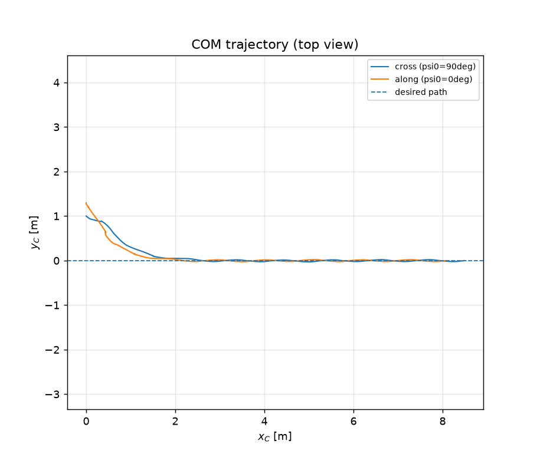 | 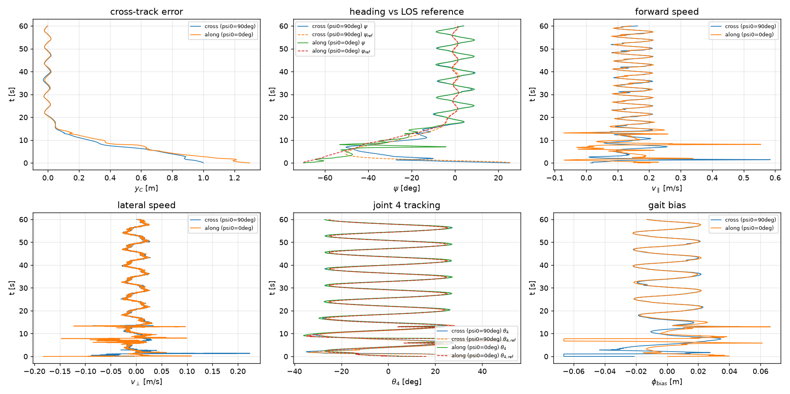 | 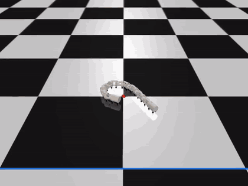 |
| 矩形 | 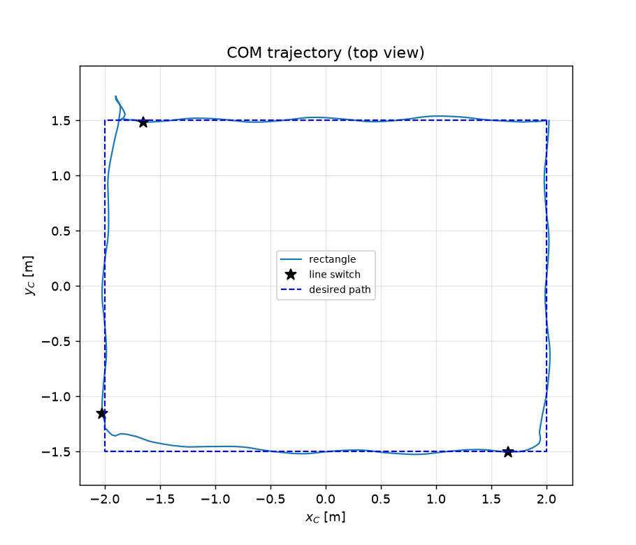 | 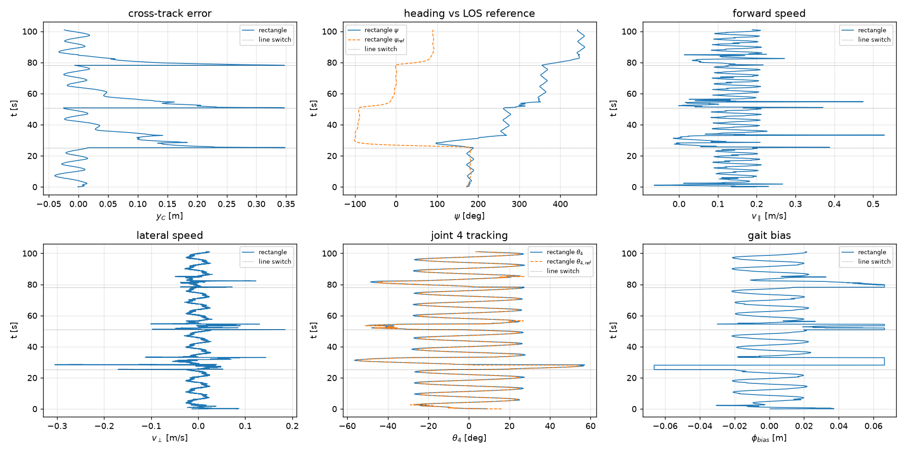 | 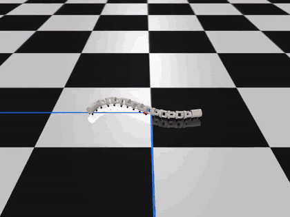 |
| 三角形 | 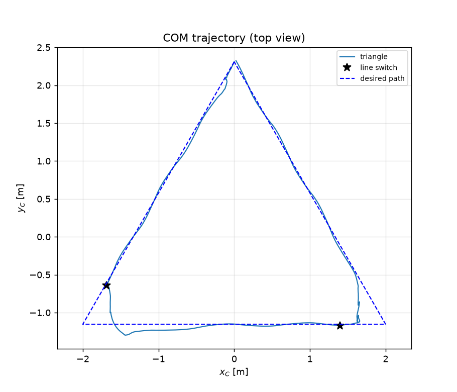 | 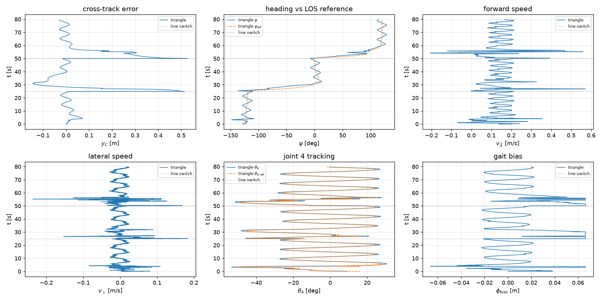 | 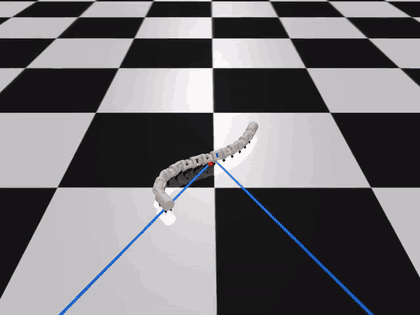 |

#### [snake-any-curve-path-following](https://github.com/RL2-snake-robot/snake-any-curve-path-following)

复现 ROBIO 2019 论文 *Any Curve Path Following of Snake-like Robots*（DOI `10.1109/ROBIO49542.2019.8961419`）。同一控制律（Eq. 5–7 + Eq. 13，带 `ff-fade` 修正）让 **14DOF-DW的蛇头** 跟踪 8 条不同隐式曲线，并逐条与原式对照。

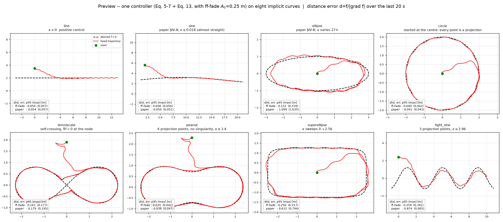

八条曲线的 MuJoCo 场景录像（6 倍速）：蓝色为期望曲线，红色为头部已走过的轨迹。

| 直线（κ≡0） | 正弦 | 椭圆 | 圆 |
| :---: | :---: | :---: | :---: |
| 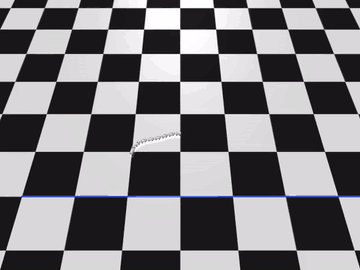 | 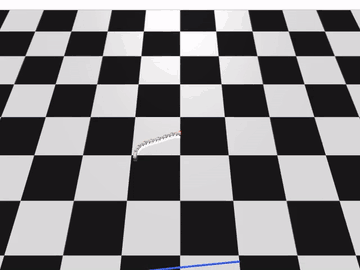 | 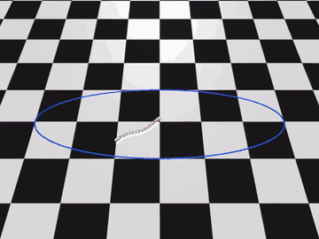 | 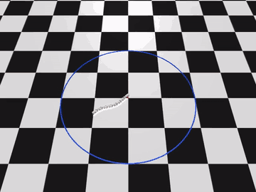 |

| 双纽线 | 瘦花生 | 超椭圆 | 紧正弦 |
| :---: | :---: | :---: | :---: |
| 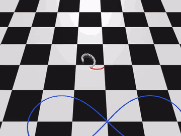 | 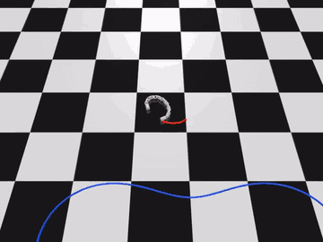 | 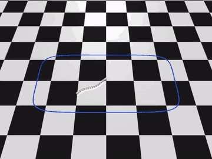 | 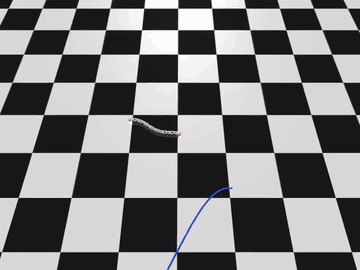 |

#### [snake-unified-motion-modeling-backbone-curve](https://github.com/RL2-snake-robot/snake-unified-motion-modeling-backbone-curve)

复现 T-RO 2024 论文 *A Unified Motion Modeling Approach for Snake Robot's Gaits Generated With Backbone Curve Method*（DOI `10.1109/TRO.2024.3420803`），用自带的 **14DOF-NW** MuJoCo 模型复核「曲线 → 关节指令 → 接地执行」这条链路，输出 S-pedal / sidewinding / crawler 三种步态。

| S-pedal | sidewinding | crawler |
| :---: | :---: | :---: |
| 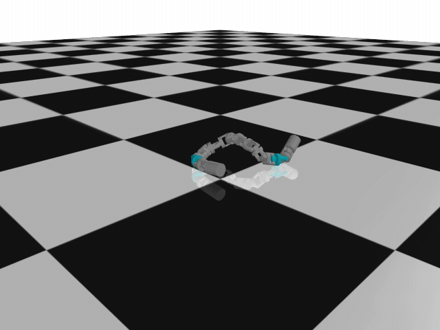 | 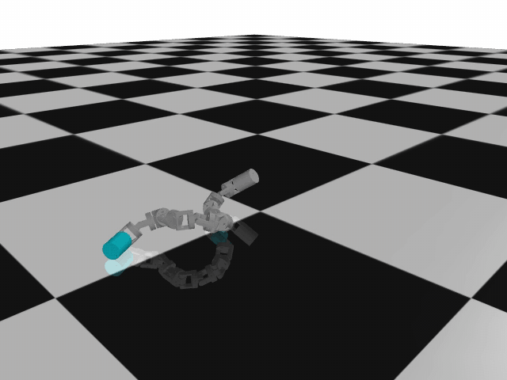 | 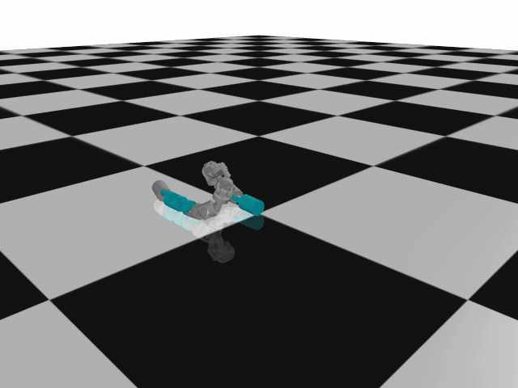 |


#### [snake-helical-climbing-motion](https://github.com/RL2-snake-robot/snake-helical-climbing-motion)

复现 TMECH 2023 论文 *A Robust Model-Based Radius Estimation Approach for Helical Climbing Motion of Snake Robots*（DOI `10.1109/TMECH.2023.3256419`）：仅凭舵机回读的关节角**在线反解管道半径**，再用估计值闭环调节螺旋步态，在变径管道上自适应攀爬；并补充了论文没有的管道直径扫描，给出该方法的跟踪上下限。

**正弦变径（实验 III）**

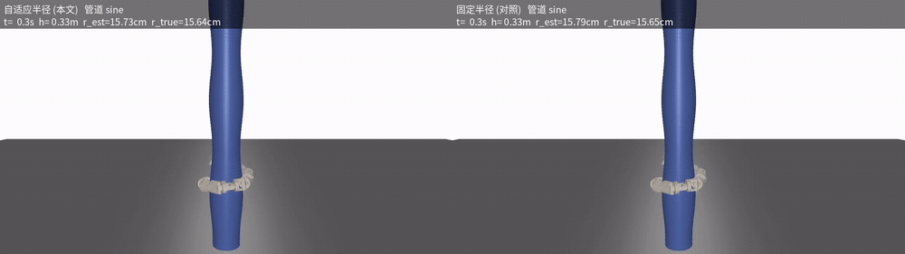

**变细 11.5→8.2 cm（实验 II）**

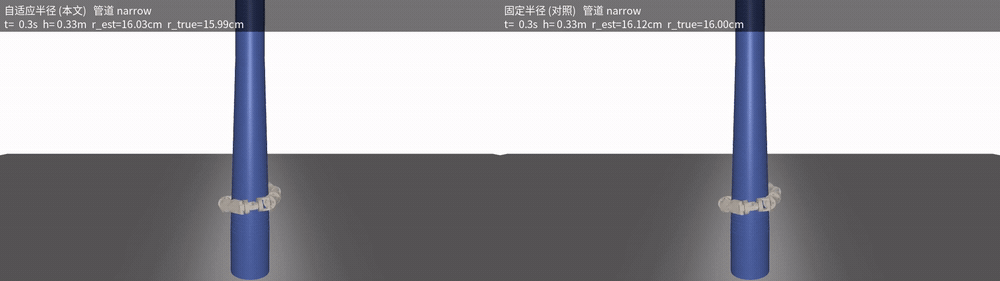

**变粗 8.2→11.5 cm（实验 I）**

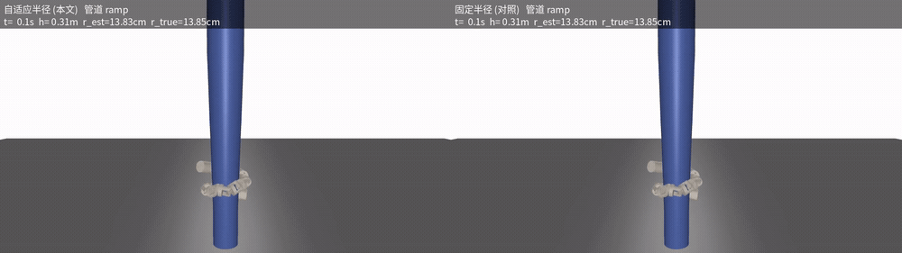

**门字形管道（补充实验 6-B）**

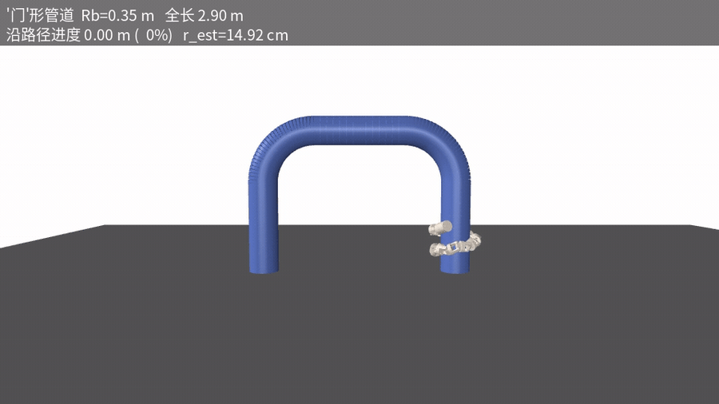

#### [snake-stair-loco](https://github.com/RL2-snake-robot/snake-stair-loco)

复现 2022 宋兴国等《基于 ROS 的蛇形机器人基本仿生运动与自主爬台阶控制》（DOI `10.13976/j.cnki.xk.2022.1321`），用自带的 **14DOF-DW** MuJoCo 模型（7 组正交关节 + 34 个轮子）在 **MuJoCo 3.11** 里跑论文 §4.1 的四种基本步态与自主爬台阶流程（原论文用 ROS + Gazebo 监控、Adams 做动力学）。

| 内容 | 说明 |
| --- | --- |
| 四种基本步态 | 同一控制函数取不同参数的四种退化形式：蜿蜒（式 4，纯偏航波）、纵向行波（式 5，竖向波）、横向翻滚（式 6，U 形侧滚）、横向行波（式 7，斜向侧移） |
| 爬台阶 | 激光测高 → 上台阶 → 走到台阶另一侧 → 下台阶；60 / 80 / 120 / 140 / 200 mm 均完成，220 mm 为实测上限，240 mm+ 失败（对应论文 §3.1「台阶过高报警」） |
| 与论文对照 | 四种步态的运动方向、所在平面、主次关系均一致；横向行波的横向速度 4.89 cm/s ≈ 论文 4.3 cm/s，其余三条偏大 2~4 倍（模型比论文样机长 44%、重 74%） |

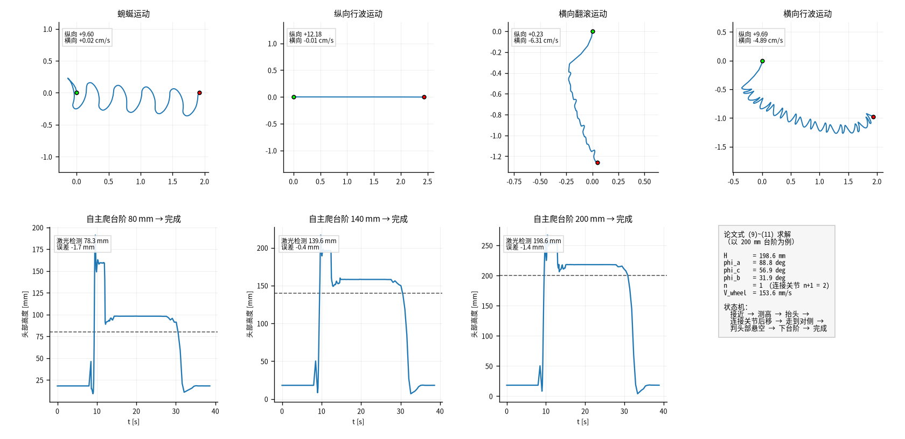

200 mm 台阶的完整爬越流程（5 倍速）：

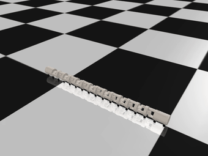

### 真机部署

#### [snake-deploy](https://github.com/RL2-snake-robot/snake-deploy)

真机部署项目：**ESP32-S3** 主控固件（PlatformIO / Arduino）+ PC 端 Python 控制与分析工具。固件以 3 个 FreeRTOS 任务通过 TCP 接收上位机下发的关节角指令、驱动总线舵机，并以 50 Hz 回传舵机状态与 IMU 姿态。

**通信结构**

| 链路 | 物理层 / 速率 | 协议与内容 |
| --- | --- | --- |
| PC ↔ ESP32-S3 | WiFi，同一局域网，TCP 端口 8888 | 指令 50 Hz / 反馈 50 Hz：关节角指令、舵机反馈、IMU 姿态 |
| ESP32-S3 → 舵机 | `Serial2`，**1 000 000 bps**（RX=GPIO1，TX=GPIO2） | STS 总线协议，14× STS 舵机（ID 1~14）位置指令与反馈 |
| IMU → ESP32-S3 | `Serial1`，**230 400 bps**（RX=GPIO19，TX=GPIO20） | WIT 标准协议：JY61P 加速度 / 角速度 / 欧拉角 / 四元数 |
| ESP32-S3 → PC | `Serial`（USB），230 400 bps | 启动物日志（IP、总线 overrun 等） |

固件侧三个 FreeRTOS 任务共享 `volatile` 全局变量：

| 任务 | 优先级 | 栈 | 周期 | 职责 |
| --- | --- | --- | --- | --- |
| `taskServo` | 3 | 8192 | 20 ms | 顺序 `FeedBack(1..14)` 读反馈；`SyncWritePosEx` 同步下发位置指令 |
| `taskImu` | 2 | 4096 | ~2 ms | 解析 JY61P 帧，缓存加速度 / 角速度 / 欧拉角 / 四元数 |
| `taskWiFi` | 1 | 8192 | 5 ms 轮询 | TCP 连接管理、指令解析、20 ms 周期回传反馈帧 |

报文格式：

- **PC → ESP32**（`\n` 结尾，token 以空格分隔）：`<id>:<pos>:<spd>:<acc> <id>:<pos>:<spd>:<acc> ...`，`pos` 取 0~4095（2048 = 0° 中位），`spd` 默认 2400，`acc` 默认 50；越界 ID 与非法 token 自动跳过。
- **ESP32 → PC**（50 Hz，一行一帧，`|` 分隔）：`D|1:pos:spd:cur|...|14:pos:spd:cur|A|ax:ay:az|G|gx:gy:gz|E|roll:pitch:yaw|Q|w:x:y:z`；连接建立时先发一行 `READY`。
- **安全模式**：无客户端连接或断开时自动进入，奇数舵机每 20 ms 朝中位 2048 逐步移动 50 计数回中（避免跳变冲击），偶数舵机跳过；客户端接入后退出，改由 PC 指令驱动。

**部署流程**

1. **改凭据**：`src/main.cpp` 顶部的 `kSsid` / `kPassword` / `kPort`（默认 8888）需与现场局域网匹配。
2. **首次装配配置 IMU**：烧录 `test/test_imu_set_baud`（把内容掩码设为 ACC+GYRO+ANGLE、波特率改 230 400、输出率改 200 Hz 并写入 flash）。**此操作永久写 IMU flash，只在换 IMU 时跑一次**；不跑则 `taskImu` 读不到数据。
3. **分阶段硬件验证**：`test/` 下每个子目录是一个独立 PlatformIO 工程，按需烧录 `test_fts_servo`（舵机三角波往返 + 逐项反馈）、`test_wifi_tcp`（双舵机 TCP 闭环）、`test_imu_uart`（IMU 全姿态量）、`test_snake_robot`（Stage 1/2/3 集成）。
4. **编译烧录取 IP**：`pio run -t upload`，再用 `pio device monitor -b 230400` 看启动日志、拿 ESP32 实际 IP。
5. **PC 端跑步态**：`pip install numpy matplotlib` → `python scripts/snake_client.py <ESP32_IP> --log --duration 10`（`--log` 自动写 `logs/serpentine_<时间戳>.csv`）。主入口组合了三部分：`SnakeComm`（连接与 50 Hz 收发回调）、`snake_gait.py`（蛇形行波 `θᵢ = A·cos(ωt + (i−1)φ)`，A=45°、ω=3.6 rad/s、φ=2.2π/7，仅下发奇数 ID）、`CsvLogger`（56 列宽表 CSV）。
6. **分析与评估**：`python scripts/batch_analyze.py` 批量跑完 `logs/*.csv` → 输出 `figs/*.png` 与 `logs/_summary.csv`。分析链路：四元数把加速度旋到世界系 → 扣重力 1 g → 梯形积分 acc→vel→pos → τ=2 s 的 EMA 扣速度漂移 → 按初始航向旋转；输出总位移、横向率 `lateral_rate`、平均/最大速度、初末偏航角等（纯 IMU 航位推算，只适合相对比较）。

关节分配：14 个舵机中**偶数 ID 上电即释放力矩**，仅**奇数 ID（1,3,5,7,9,11,13 = yaw1~yaw7）**参与运动控制，实际可控自由度为 7；偶数位仍可被轮询反馈（位置/速度/电流）。

### 模型文件

#### [snake-robot-model](https://github.com/RL2-snake-robot/snake-robot-model)

蛇形机器人模型仓库：多型号 **ROS URDF** 描述包与 **MuJoCo XML** 模型，配套 STL 网格、关节配置与 RViz / Gazebo launch 文件。涵盖 `7DOF` / `14DOF`、`NW` / `SW` / `DW` / `DW-W` 轮型、`S-` 纯偏航与 `O-` 旧版共 11 个型号。

| 型号 | 自由度 | 关节形式 | 轮子 | 目录 | 预览 |
| --- | --- | --- | --- | --- | --- |
| 7DOF-NW | 7 | 正交 | 无轮 | `7DOF-NW/` | 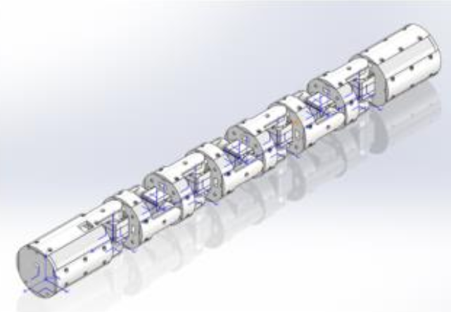 |
| 7DOF-SW | 7 | 正交 | 单轮 | `7DOF-SW/` | 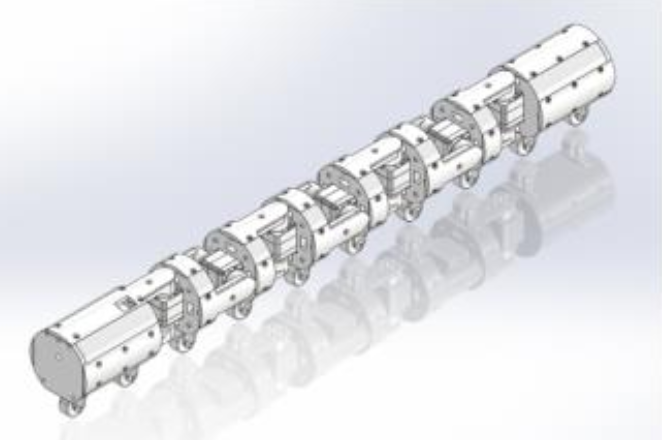 |
| 7DOF-DW | 7 | 正交 | 双轮 | `7DOF-DW/` | 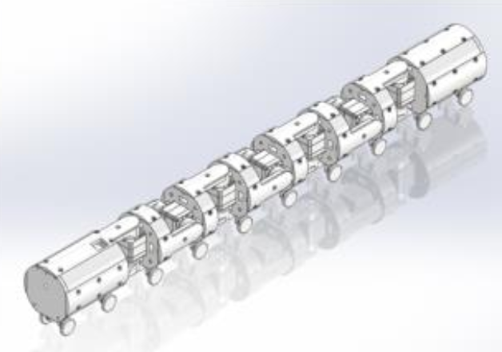 |
| S-7DOF-NW | 7 | 纯偏航 | 无轮 | `S-7DOF-NW/` | 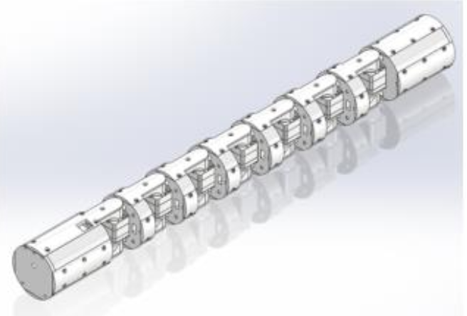 |
| S-7DOF-SW | 7 | 纯偏航 | 单轮 | `S-7DOF-SW/` | 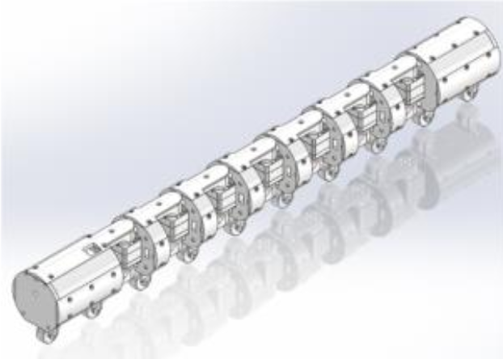 |
| S-7DOF-DW | 7 | 纯偏航 | 双轮 | `S-7DOF-DW/` |  |
| 14DOF-NW | 14 | 正交 | 无轮 | `14DOF-NW/` | 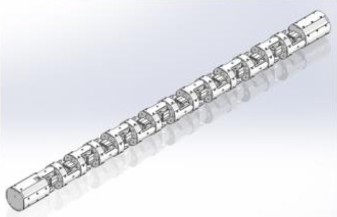 |
| 14DOF-SW | 14 | 正交 | 单轮 | `14DOF-SW/` | 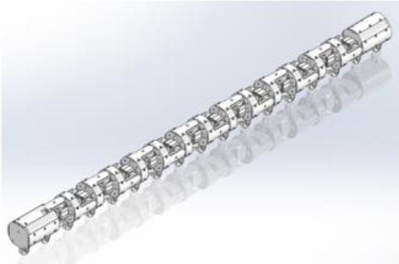 |
| 14DOF-DW | 14 | 正交 | 双轮 | `14DOF-DW/` | 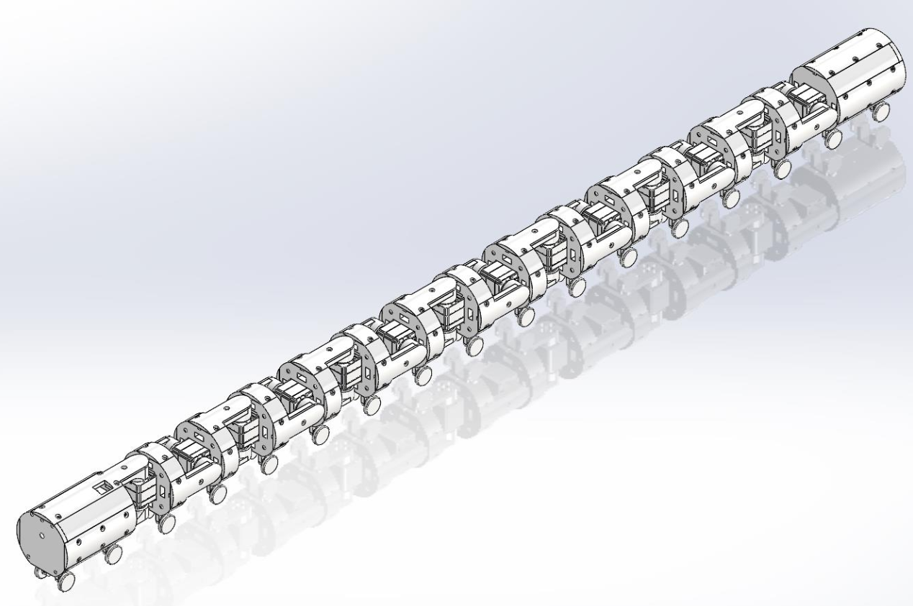 |
| 14DOF-DW-W | 14 | 正交 | 加宽双轮 | `14DOF-DW-W/` | 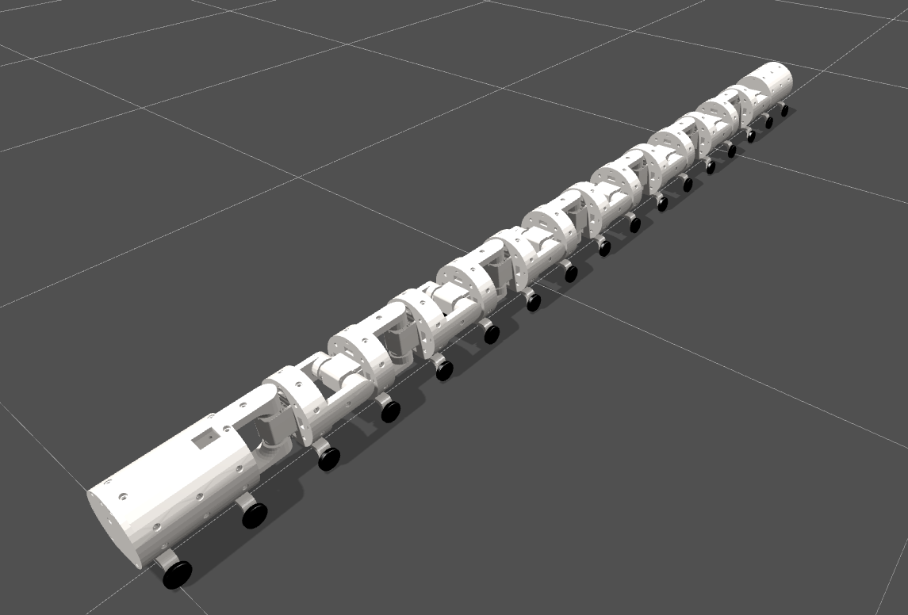 |
| O-7DOF-DW | 7 | 旧版 | 双轮 | `O-7DOF-DW/` | 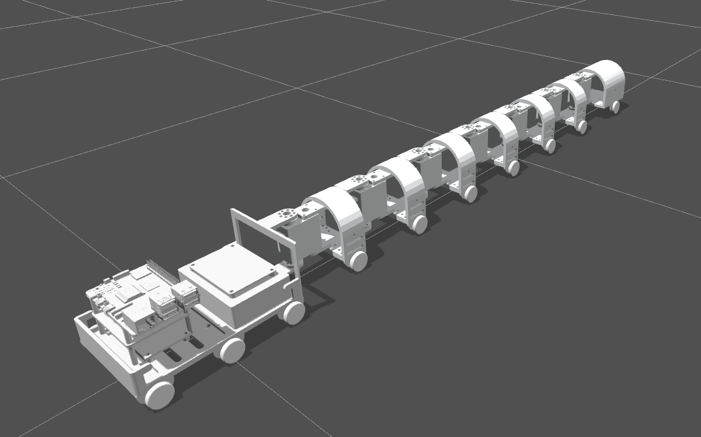 |
